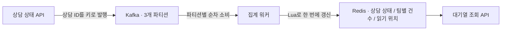

# 상담 대기열 집계 · Consult Queue Ledger

[](https://github.com/hankctc21/consult-queue-ledger/actions/workflows/verify.yml)

같은 상담이 두 번 접수되거나 다른 팀으로 넘어가도 대기 인원은 정확해야 합니다. 이 개인 프로젝트는 상담 시스템이 발행한 상태 변경을 Kafka에 보관하고, Redis에서 팀별 **대기·진행·완료 건수**를 바로 조회합니다. 가상의 상담 ID만 사용합니다.



## 숫자로 보는 한 건의 이관

| 들어온 이벤트 | 일반팀 대기 | 일반팀 진행 | 보상팀 진행 | 판단 |
| --- | ---: | ---: | ---: | --- |
| CASE-42, v1, 일반팀 대기 | 1 | 0 | 0 | 최초 접수 |
| 같은 내용의 v1 재전송 | 1 | 0 | 0 | 중복 |
| v2, 일반팀 진행 | 0 | 1 | 0 | 대기에서 진행으로 이동 |
| 뒤늦게 도착한 v1 | 0 | 1 | 0 | 이전 버전 |
| v2인데 상태가 완료 | 0 | 1 | 0 | 같은 버전의 충돌로 기록 |
| v3, 보상팀 진행 | 0 | 0 | 1 | 이전 팀에서 차감하고 새 팀에 가산 |

## 구현 과정에서 해결한 문제

**다시 읽은 것과 다시 접수된 것을 어떻게 구별할까?** 같은 Kafka 위치를 다시 적용하면 이미 처리한 레코드입니다. 같은 상담이 새 Kafka 위치에 다시 접수되면 업무 버전과 현재 상태를 비교합니다. 두 경우를 나눠야 운영자가 재접수 횟수를 볼 수 있고, 상담 인원도 두 번 늘어나지 않습니다.

**집계는 바뀌었는데 워커가 멈추면 어디서 시작할까?** 이전 상태 차감, 새 상태 가산, 상담별 최신 버전, 파티션의 다음 읽기 위치를 Redis Lua 스크립트 한 번으로 반영합니다. 읽기 위치의 기준은 Redis입니다. Kafka 소비자 그룹은 파티션을 나누는 데 사용하며, 워커는 배정 시 Redis 위치로 이동합니다. 입력 형식 오류는 위치 및 오류 건수를 남기고 다음 레코드를 처리합니다.

**Redis 전체 집계를 잃으면 어떻게 검증할까?** 워커를 정지한 뒤 이 프로젝트의 테스트용 키만 비우고 같은 Kafka 이력을 처음부터 다시 읽습니다. 통합 시험은 복구 전후 두 팀의 상태별 수치, 처리 결과별 건수, 파티션별 다음 위치가 모두 일치하는지 비교합니다. 같은 버전에서 서로 다른 값이 오면 먼저 반영한 값을 유지하고 충돌을 셉니다.

| 구성 | 사용 기술과 역할 |
| --- | --- |
| API | Python 3.12 · FastAPI · Pydantic. 입력 검증, Kafka 발행 확인, Redis 조회 |
| 이벤트 | Apache Kafka 3.9.1 · confluent-kafka. 상담 ID를 레코드 키로 사용 |
| 집계 | Redis 7.4 · Lua. 키 네 개에 체크포인트, 상담 최신 상태, 대기열 카운터, 처리 통계 저장 |
| 검증 | unittest · Docker Compose · GitHub Actions. 실제 브로커와 Redis를 사용하는 복구 시나리오 |

## 로컬 실행

Python 3.12와 Docker Compose v2가 필요합니다. 아래 명령은 저장소 루트에서 실행합니다.

```sh
docker compose up -d --wait
python -m venv .venv
```

가상환경을 활성화합니다. PowerShell에서는 `.\.venv\Scripts\Activate.ps1`, macOS/Linux에서는 `source .venv/bin/activate`입니다.

```sh
python -m pip install --only-binary=:all: -r requirements.txt
python -m queueboard.init_topic
python -m queueboard.worker
```

별도 터미널에서 같은 가상환경을 활성화하고 `python -m uvicorn queueboard.api:app`을 실행합니다. [로컬 API 화면](http://127.0.0.1:8000/docs)에서 아래 데이터로 `POST /events`를 호출하고 `GET /queues/general`을 조회합니다.

```json
{"ticket_id":"CASE-42","version":1,"queue":"general","status":"waiting"}
```

- `POST /events`는 브로커가 확인한 뒤 202와 파티션·오프셋을 반환합니다. 집계는 비동기입니다. 503이면 동일 상담 ID·버전·내용으로 재시도할 수 있습니다.
- `GET /queues/{name}`은 조회 시점의 Redis 상태를 반환합니다. `GET /progress`에서 파티션별 다음 위치와 applied, duplicate, stale, conflict, invalid 건수를 확인합니다.
- 이벤트 생산자가 상담별 단조 증가 버전을 발급합니다. 전체 상태 스냅샷을 보내므로 중간 버전이 누락되어도 더 높은 버전을 반영합니다. 운영 건수는 현재 상태별 상담 수이며 누적 처리량이 아닙니다.

## 검증 실행

```sh
python -m unittest discover -s tests -v
docker compose up -d --wait
python -m tests.integration
```

통합 시험은 실행별 임시 토픽·소비자 그룹·Redis 키를 생성합니다. API와 브로커, 워커 프로세스, Redis Lua를 연결합니다. 최초 접수 반영 후 워커를 종료한 상태로 후속 이벤트를 적재하고, 재기동 후 **일반팀 0건 / 보상팀 진행 1건·완료 1건**을 검증합니다. 그다음 Redis 집계를 비우고 동일 결과와 읽기 위치를 다시 확인합니다. 테스트 데이터와 임시 토픽은 종료 시 정리합니다. [검증 실행 내역](https://github.com/hankctc21/consult-queue-ledger/actions/workflows/verify.yml)

## 설계 범위

- 로컬 단일 브로커·단일 Redis 구성입니다. Kafka 이력을 보존하기 위해 데모 토픽의 시간·크기 기반 만료를 껐습니다. 운영 환경에서는 보존 기간과 스냅샷을 함께 설계해야 합니다.
- 재생하는 동안 조회 결과에는 그 시점까지 처리한 데이터만 보입니다. 무중단 전환이나 임의의 Redis 키 하나만 손실된 상태의 자동 수선은 지원 범위 밖입니다. Redis는 전용 키 공간, AOF 및 noeviction 설정을 전제합니다.
- Kafka 토픽의 파티션 수와 키 규칙은 고정합니다. 저장된 위치가 브로커의 보존 범위를 벗어나면 워커가 중단됩니다. 잘못된 위치에서 임의로 집계를 이어가지 않습니다.
- API·브로커·Redis는 로컬 루프백에서 사용합니다. 사용자 인증, 다중 노드 장애 전환, 대규모 부하 성능은 이 프로젝트의 시험 대상에서 제외했습니다.

[Kafka Python 클라이언트](https://docs.confluent.io/platform/current/clients/confluent-kafka-python/html/index.html) · [Redis Lua 실행 모델](https://redis.io/docs/latest/develop/programmability/eval-intro/)
